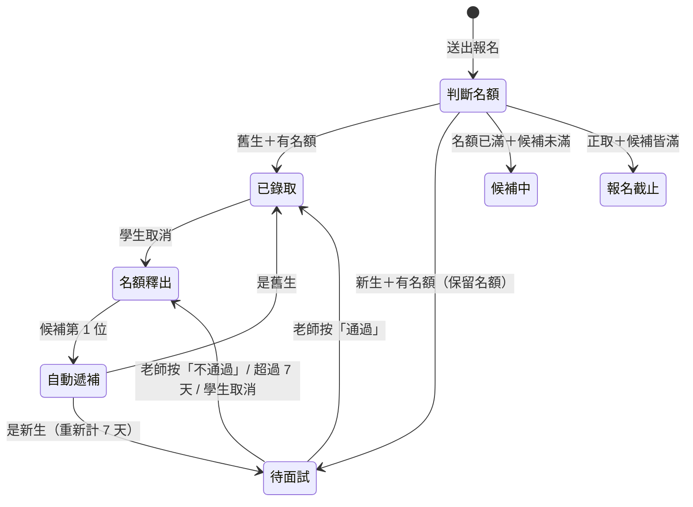

# 僻靜營報名流程設計

> 目標：老師只需要做「面試完按一下 通過／不通過」，其餘（收件、算名額、候補遞補、通知）全部自動。

---

## 1. 基本設定（每期開營前設定一次）

| 項目 | 建議值 | 說明 |
|---|---|---|
| 正取名額 | 15 | 一期僻靜營人數 |
| 候補名額 | 5 | 候補滿了就自動關閉報名 |
| 面試期限 | 報名後 7 天 | 逾期未完成面試，自動釋出名額 |
| 遞補截止日 | 開營前 5 天 | 之後釋出的名額不再遞補（避免臨時通知） |
| 老師 LINE | 連結＋QR Code | 自動顯示在新生的報名完成頁和通知信 |

---

## 2. 兩條報名連結（關鍵設計）

如何分辨「新生 / 舊生」不需要老師一個一個判斷：

- **舊生連結**：老師只要把這個連結貼到既有的學生 LINE 群組一次。從這個連結報名的人視為舊生。
- **公開連結**：放在 IG、FB、官網，從這裡報名的人視為新生。

> 備援：若有人從公開連結報名但姓名＋電話與 Vivian Yoga App 裡的學生名單相符，系統也自動當成舊生，老師不用處理。

---

## 3. 學生端流程

### 舊生（全自動）
1. 打開舊生連結 → 填姓名、電話、Email、緊急聯絡人、身體狀況
2. 送出 → 畫面立刻顯示 **「報名成功 ✅」**（或「候補第 N 位」）
3. 收到確認 Email

### 新生（需面試）
1. 打開公開連結 → 填基本資料 **＋「想參加的原因」**
2. 送出 → 名額先幫他**保留**，畫面顯示：
   「已收到報名，請在 7 天內加老師 LINE 約面試」＋老師 LINE QR Code
3. 學生主動加 LINE 約時間（老師不用主動聯絡）
4. 面試後老師按「通過」→ 學生收到 **「錄取通知 ✅」**
   老師按「不通過」→ 學生收到婉拒信，名額自動釋出

---

## 4. 狀態與自動規則



**名額計算**：`已錄取 + 待面試` 合計 ≤ 15。待面試的新生也佔名額，這樣才公平（依報名先後），也不會發生「面試通過卻沒位子」的情況。

**自動遞補**：任何名額釋出時，候補第 1 位自動補上，系統同時寄信通知他。若他是新生，進入「待面試」並附上老師 LINE。候補空出的位置會重新開放報名。

**自動提醒**：
- 新生報名第 5 天還沒面試 → 提醒學生（「還有 2 天」）
- 第 7 天到期 → 自動釋出名額、通知學生、遞補下一位

---

## 5. 老師要做的事（只有這些）

| 時機 | 老師的動作 | 次數 |
|---|---|---|
| 開營前 | 填日期、地點、費用（名額已有預設值） | 1 次 |
| 開營前 | 把「舊生連結」貼到學生 LINE 群組 | 1 次 |
| 每位新生面試後 | 在手機上按 **「通過」** 或 **「不通過」** | 每位新生 1 次 |

其他全部自動。老師手機上的畫面只有一張清單：

```
┌──────────────────────────────┐
│ 2026 秋季僻靜營   已錄取 12/15 │
│ 待面試 2   候補 3              │
├──────────────────────────────┤
│ 🟡 待面試                      │
│ 王小美  10/18 報名  剩 3 天     │
│ 「最近工作壓力大，想找回…」     │
│   [ ✅ 通過 ]   [ ❌ 不通過 ]   │
│                                │
│ 林大明  10/20 報名  剩 5 天     │
│ 「練習兩年，想深入靜坐…」       │
│   [ ✅ 通過 ]   [ ❌ 不通過 ]   │
├──────────────────────────────┤
│ 🟢 已錄取（12）  ▸             │
│ ⚪ 候補（3）     ▸             │
└──────────────────────────────┘
```

- 按鈕要大、一畫面只做一件事、按錯可以「復原」。
- 有新生報名時，老師會收到一則通知（Email 或 LINE 官方帳號訊息）：「王小美報名了，原因：…」，點進去就是上面的畫面。
- 學生要取消時，點自己確認信裡的「取消報名」連結即可，不用經過老師。

---

## 6. 報名表欄位

| 欄位 | 舊生 | 新生 |
|---|---|---|
| 姓名、電話、Email | ✅ | ✅ |
| LINE 名稱（方便老師認人） | ✅ | ✅ |
| 緊急聯絡人 | ✅ | ✅ |
| 身體狀況／飲食限制 | ✅ | ✅ |
| 瑜伽經驗 | — | ✅ |
| **想參加的原因** | — | ✅（必填） |

報名頁上方即時顯示「剩餘名額 3 / 15」或「目前候補第 2 位」。

---

## 7. 技術建議（沿用現有架構）

現在的 Vivian Yoga App 已經用 Google Apps Script ＋ Google 試算表同步資料，僻靜營直接沿用：

- **報名頁** `retreat.html`：手機版單頁表單，資料送到 Apps Script。
- **Apps Script**：負責算名額、決定狀態、寄 Email、每天定時檢查面試是否逾期（時間觸發器）。用 `LockService` 防止兩人同時搶最後一個名額。
- **Google 試算表**新增一個「僻靜營」工作表，一列一位報名者（狀態、報名時間、面試期限…），老師也能直接打開看。
- **老師端**：在現有 App 新增一個「僻靜營」分頁，就是第 5 節的清單畫面。
- **通知**：學生端用 Email（Apps Script `MailApp`，免費）。
  老師端可用 Email，或 LINE 官方帳號的 Messaging API（LINE Notify 已於 2025 年停止服務）。

---

## 8. 待確認的問題

1. **費用／訂金**：錄取後是否要匯款？若要，可加入「錄取後 3 天內匯款，逾期釋出名額」，老師只需確認收款（或用付款連結自動對帳）。
2. **候補中的新生能否先面試？** 可以讓他們提前面試，遞補時就直接錄取，能縮短遞補時間，但老師會多面試一些最後可能沒補上的人。
3. 面試期限 7 天、候補 5 位、遞補截止開營前 5 天，這些數字是否合適？
4. 舊生是否也要優先報名期（例如舊生連結提早 3 天開放）？
