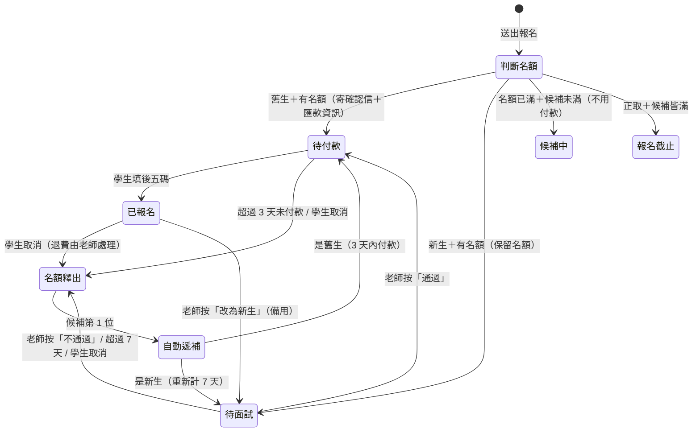

# Sucharita 老師僻靜營報名流程設計

> 目標：老師只需要做「面試完按一下 通過／不通過」，其餘（收件、算名額、候補遞補、通知）全部自動，通知寄到老師的信箱。

---

## 1. 基本設定（每期開營前設定一次）

| 項目 | 設定值 | 說明 |
|---|---|---|
| 正取名額 | 15 | 一期僻靜營人數 |
| 候補名額 | 5 | 候補滿了就自動關閉報名 |
| 本期活動 | 2026 秋季斷食營，11/21（六）– 11/25（三） | 遞補截止：11/16（一） |
| 費用 | 舊生 NT$15,000、新生 NT$17,500 | 報名頁同時列出；付款頁依新生／舊生顯示對應金額 |
| 地點 | 台東 Yoga House | |
| 匯款帳號 | 銀行代號 007 第一銀行安南分行，帳號 60868063788，戶名 徐淑萍 | 顯示在付款頁和付款通知信 |
| 老師信箱 | sucharita@ouryogahouse.com | 接收報名、付款、釋出名額等通知 |
| 行前通知 | 開營前 2 天（11/19）自動寄出 | 寄給所有已報名的學生：抵達時間、交通、地址與聯絡方式、需帶物品。內容存在系統設定（試算表）裡，不放在公開的報名頁或官網 |
| 面試期限 | 報名後 7 天 | 逾期未完成面試，自動釋出名額 |
| 付款期限 | 通知後 3 天 | 面試通過或候補遞補後，3 天內未填後五碼，自動釋出名額 |
| 遞補截止日 | 開營前 5 天 | 之後釋出的名額不再遞補（避免臨時通知） |
| 老師 LINE | 連結＋QR Code | 顯示在新生的報名完成頁和通知信，讓學生約面試 |

### 每期開始前（一年兩次，約 5 分鐘）

老師打開「開新一期」頁面，系統會**自動帶入上一期的設定**，只改有變的地方：

| 要改 | 通常不用改（沿用上一期） |
|---|---|
| 活動名稱（例：2027 春季僻靜營） | 正取 15 位、候補 5 位 |
| 日期 | 匯款帳號、老師信箱 |
| 費用（有調整才改） | 面試 7 天、付款 3 天 |
| 行前通知內容（有變才改） | 報名表題目 |

按「開放報名」後，系統自動：
- 依日期算好**遞補截止日**（開營前 5 天）和**行前通知日**（開營前 2 天）
- 把上一期名單**封存**（試算表另存一頁，隨時可查），名額歸零重新計算
- **報名連結不變**：老師把同一條連結再貼一次到 LINE 群組／IG 就好

兩期之間，報名連結會顯示「下一期尚未開放，開放時會在 LINE 群組公告」。

### 放在官網上（ouryogahouse.com）

報名頁的網址固定不變，內容會自動顯示目前這一期，所以官網只要**設定一次**，之後每期都不用改：

- **✅ 採用做法 A：官網放一個「報名」按鈕**，連到報名頁。任何架站平台都能做，最穩定。
  - 建議按鈕文字：「僻靜營報名」；按鈕旁可註明「新生需先與老師面試」。
  - 連結設定成「在新分頁開啟」，學生報完名還能回到官網。
- 做法 B（之後再考慮）：把報名表嵌入官網頁面（iframe），學生不用離開官網就能報名。大多數架站平台（Wix、Squarespace、WordPress、Google 協作平台）都有「嵌入網頁／HTML」的元件。
- 也可以設定成老師網域的網址，例如 `retreat.ouryogahouse.com`，看起來更像官網的一部分。

---

## 2. 同一條報名連結，學生自己選新生／舊生

新生、舊生都用**同一條連結**，表單第一題問：

> 你參加過 Sucharita 老師的課程或僻靜營嗎？　○ 參加過（舊生）　○ 第一次（新生）

不做名單比對，以學生自己的選擇為準。老師每次有人報名都會收到 Email 通知（含姓名），萬一看到不認識的「舊生」，可以按 **「改為新生」** 讓他改走面試流程（備用功能，平常不用）。

---

## 3. 學生端流程

### 舊生：填資料送出 → 收確認信（含匯款資訊）→ 轉帳後回填後五碼
1. 打開報名連結，頁面上方顯示「剩餘名額 3 / 15」
2. 選「參加過」→ 填報名資料 → 按「送出報名」（報名時**不用**填後五碼）
3. 畫面顯示「報名成功，請完成付款」，名額先保留 **3 天**
4. 收到確認 Email：舊生費用、匯款資訊（銀行代號、帳號、戶名）＋**回填後五碼的連結**
5. 學生轉帳後點信中連結 → 填匯款帳號後五碼 → 收到「付款完成」確認信
6. 3 天內沒回填 → 前一天提醒，到期自動釋出名額給候補
7. 若名額已滿：填完資料直接「登記候補（第 N 位）」，**不用先付款**；遞補到時再寄付款連結

> 試用版：[`retreat-signup-prototype.html`](retreat-signup-prototype.html)　流程圖：[`retreat-signup-diagram.html`](retreat-signup-diagram.html)

### 新生：填表 → 傳 LINE 約面試 → 通過後付款
1. 打開報名連結、選「第一次」→ 填基本資料 **＋「想參加的原因」**（這時不用付款）
2. 送出 → 名額先幫他**保留**，畫面顯示：
   「已收到報名，請傳 LINE 給老師約面試（7 天內）」＋老師 LINE QR Code／按鈕
3. 學生自己傳 LINE 給老師約時間（老師不用主動聯絡）
4. 面試後老師按「通過」→ 學生收到 Email：**「面試通過！請於 3 天內轉帳（新生費用）並填寫後五碼」**＋付款連結
5. 學生轉帳、在付款連結填後五碼 → **「報名成功 ✅」**
   老師按「不通過」→ 學生收到婉拒信，名額自動釋出

---

## 4. 狀態與自動規則



**名額計算**：`已報名 + 待付款 + 待面試` 合計 ≤ 15。待面試、待付款的人都佔名額，依報名先後最公平，也不會發生「面試通過卻沒位子」或「付了錢卻沒位子」。

**自動遞補**：任何名額釋出時，候補第 1 位自動補上並收到通知——舊生收到付款通知，新生收到「請傳 LINE 約面試」。候補空出的位置會重新開放報名。

**自動提醒**（寄給學生）：
- 新生報名第 5 天還沒面試 →「還有 2 天」
- 待付款第 2 天還沒填後五碼 →「明天到期」
- 到期 → 自動釋出名額、通知學生、遞補下一位


---

## 5. 老師要做的事（只有這些）

| 時機 | 老師的動作 | 次數 |
|---|---|---|
| 開營前 | 填日期、地點、費用、匯款帳號 | 1 次 |
| 開營前 | 把報名連結貼到學生 LINE 群組／IG／FB | 1 次 |
| 每位新生面試後 | 按 **「通過」** 或 **「不通過」** | 每位新生 1 次 |
| 開營前（可選） | 用清單上的「後五碼」對一下存摺 | 1 次 |

### 老師收到的通知（Email）

不使用 LINE 官方帳號。通知信寄到 **sucharita@ouryogahouse.com**，手機信箱會跳通知，老師看看就好、不用回信：

- 🆕 新生報名：王小美，原因：…（附名單頁連結）
- ✅ 舊生報名成功：陳大華，後五碼 12345，目前 13/15
- 🔄 林小芳 逾期未面試，名額已釋出，已自動遞補：張美美（舊生，待付款）
- 📮 已寄出行前通知給 15 位

新生本來就會自己傳 LINE 給老師約面試，那則私訊就是老師要面試的提醒，所以不需要另外的即時推播。

### 名單頁（加到手機主畫面）

面試完打開名單頁，按「通過」或「不通過」。所有報名、候補、遞補結果都在這裡。

```
┌──────────────────────────────┐
│ 2026 秋季斷食營   已報名 11/15 │
│ 待付款 1   待面試 2   候補 3    │
├──────────────────────────────┤
│ 🟡 待面試                      │
│ 王小美  10/18 報名  剩 3 天     │
│ 「最近工作壓力大，想找回…」     │
│   [ ✅ 通過 ]   [ ❌ 不通過 ]   │
├──────────────────────────────┤
│ 🟠 待付款（1）   ▸             │
│ 🟢 已報名（11）  ▸  含後五碼    │
│ ⚪ 候補（3）     ▸             │
└──────────────────────────────┘
```

學生要取消時，點自己確認信裡的「取消報名」連結即可，老師會收到 Email 通知（已付款者需老師退款）。

---

## 6. 報名表欄位

沿用老師原本的「Yoga House Retreat」報名表，**新生、舊生填同一份**，題目中英對照。第一題「你參加過老師的課程或僻靜營嗎？」決定後面走新生或舊生流程。

| 區塊 | 欄位 | 必填 |
|---|---|---|
| 個人資料 | 中文名字、地址、行動電話、Email、出生年月日、現職 | ✅ |
| | 英文暱稱、住家電話、LINE ID | 選填 |
| 緊急聯絡人 | 姓名、行動電話、關係 | ✅ |
| 關於你 | 1. 從哪裡獲知 Yoga House 課程的資訊 | ✅ |
| | 2. 學多久瑜珈、敘述你的練習 | ✅ |
| | 3. 為什麼選擇參加這次的營隊（新生面試前老師會先看） | ✅ |
| 個人就醫史 | 1. 是否接受過心理治療（是 → 請敘述） | ✅ |
| | 2. 是否懷孕或計畫懷孕 | ✅ |
| | 3. 是否有身體或心理狀況在復原中（是 → 請敘述） | ✅ |
| | 4. 其他需要知道的就醫史（沒有寫「無」） | ✅ |

匯款帳號後五碼不在報名表上，轉帳後從確認信（舊生）或付款通知信（新生）的連結回填。

老師名單上，就醫史有「是」或有填其他事項的學生會標示 **就醫史**，並列出內容，方便老師面試和營期中留意。就醫史屬於敏感資料，只存在系統的試算表裡，不會出現在任何公開頁面。

---

## 7. 技術建議

獨立的一套小系統，資料放在一個 Google 帳號裡，老師不用安裝任何東西：

- **報名頁**：手機版單頁表單，即時顯示剩餘名額，資料送到 Google Apps Script。
- **Google Apps Script**：算名額、決定狀態、寄 Email、每天定時檢查面試／付款是否逾期（時間觸發器）。用 `LockService` 防止兩人同時搶最後一個名額。
- **Google 試算表**：一列一位報名者（狀態、報名時間、期限、後五碼…），老師也能直接打開看或匯出名單。
- **老師名單頁**：手機網頁，加到主畫面，面試後在這裡按「通過／不通過」。
- **通知**：學生和老師都用 Email（Apps Script `MailApp`，免費；一般 Gmail 每天上限 100 封，一期夠用）。不使用 LINE 官方帳號。
- **行前通知**：時間觸發器在開營前 2 天自動寄給所有已報名的學生。

### 還需要準備的東西
1. 一個 Google 帳號（放試算表和 Apps Script；寄給學生的信會從這個帳號寄出）
2. ~~行前通知的內容~~（已提供；含不公開的地址，只存在系統設定中）
3. 老師的 LINE 連結或 QR Code（顯示在新生完成頁）
