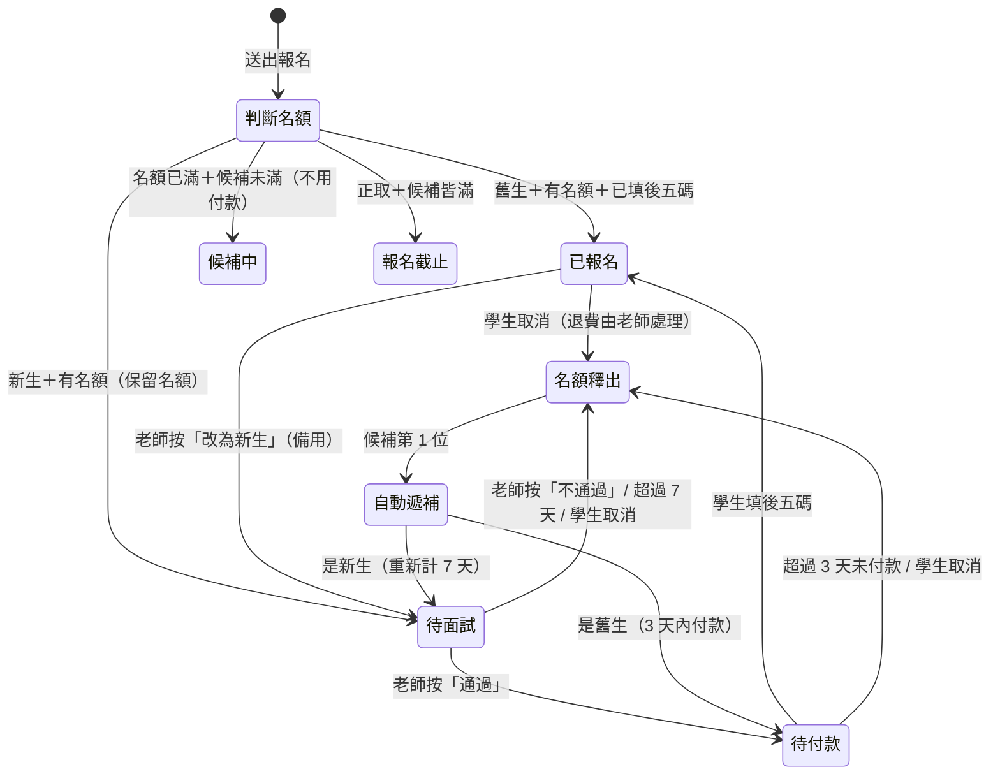

# Sucharita 老師僻靜營報名流程設計

> 目標：老師只需要做「面試完按一下 通過／不通過」，其餘（收件、算名額、候補遞補、通知）全部自動，通知都送到老師的 LINE。

---

## 1. 基本設定（每期開營前設定一次）

| 項目 | 設定值 | 說明 |
|---|---|---|
| 正取名額 | 15 | 一期僻靜營人數 |
| 候補名額 | 5 | 候補滿了就自動關閉報名 |
| 本期活動 | 2026 秋季斷食營，10/21（三）– 10/25（日） | |
| 費用 | 舊生 NT$15,000、新生 NT$17,500 | 報名頁同時列出；付款頁依新生／舊生顯示對應金額 |
| 地點 | 台東 Yoga House | |
| 匯款帳號 | 老師填 | 顯示在付款頁和通知信 |
| 面試期限 | 報名後 7 天 | 逾期未完成面試，自動釋出名額 |
| 付款期限 | 通知後 3 天 | 面試通過或候補遞補後，3 天內未填後五碼，自動釋出名額 |
| 遞補截止日 | 開營前 5 天 | 之後釋出的名額不再遞補（避免臨時通知） |
| 老師 LINE | 連結＋QR Code | 顯示在新生的報名完成頁和通知信，讓學生約面試 |

---

## 2. 同一條報名連結，學生自己選新生／舊生

新生、舊生都用**同一條連結**，表單第一題問：

> 你參加過 Sucharita 老師的課程或僻靜營嗎？　○ 參加過（舊生）　○ 第一次（新生）

不做名單比對，以學生自己的選擇為準。老師每次有人報名都會在 LINE 收到通知（含姓名），萬一看到不認識的「舊生」，可以按 **「改為新生」** 讓他改走面試流程（備用功能，平常不用）。

---

## 3. 學生端流程

### 舊生：填資料 → 看到匯款帳號 → 填後五碼 = 報名成功
1. 打開報名連結，頁面上方顯示「剩餘名額 3 / 15」
2. 選「參加過」→ 填報名資料 → 按「下一步：付款」
3. 畫面顯示**舊生費用**與匯款帳號（可一鍵複製）→ 學生轉帳 → 填**匯款帳號後五碼** → 按「完成報名」
4. 畫面立刻顯示 **「報名成功 ✅」**，並收到確認 Email
5. 若名額已滿：填完資料直接「登記候補（第 N 位）」，不顯示匯款帳號，**不用先付款**；遞補到時再寄付款連結

> 試用版：[`retreat-signup-prototype.html`](retreat-signup-prototype.html)　流程圖：[`retreat-signup-diagram.html`](retreat-signup-diagram.html)

### 新生：填表 → 傳 LINE 約面試 → 通過後付款
1. 打開報名連結、選「第一次」→ 填基本資料 **＋「想參加的原因」**（這時不用付款）
2. 送出 → 名額先幫他**保留**，畫面顯示：
   「已收到報名，請傳 LINE 給老師約面試（7 天內）」＋老師 LINE QR Code／按鈕
3. 學生自己傳 LINE 給老師約時間（老師不用主動聯絡）
4. 面試後老師按「通過」→ 學生收到 Email：**「面試通過！請於 3 天內轉帳（新生費用）並填寫後五碼」**＋付款連結
5. 學生轉帳、在付款連結填後五碼 → **「報名成功 ✅」**
   老師按「不通過」→ 學生收到婉拒信，名額自動釋出

---

## 4. 狀態與自動規則



**名額計算**：`已報名 + 待付款 + 待面試` 合計 ≤ 15。待面試、待付款的人都佔名額，依報名先後最公平，也不會發生「面試通過卻沒位子」或「付了錢卻沒位子」。

**自動遞補**：任何名額釋出時，候補第 1 位自動補上並收到通知——舊生收到付款通知，新生收到「請傳 LINE 約面試」。候補空出的位置會重新開放報名。

**自動提醒**（寄給學生）：
- 新生報名第 5 天還沒面試 →「還有 2 天」
- 待付款第 2 天還沒填後五碼 →「明天到期」
- 到期 → 自動釋出名額、通知學生、遞補下一位

**特殊情況**：舊生轉帳後、送出前剛好最後一個名額被搶走（機率很低）→ 自動排到候補第 1 位並標記「已付款」，老師會收到 LINE 通知；若最後沒遞補到，由老師退款。

---

## 5. 老師要做的事（只有這些）

| 時機 | 老師的動作 | 次數 |
|---|---|---|
| 開營前 | 填日期、地點、費用、匯款帳號 | 1 次 |
| 開營前 | 把報名連結貼到學生 LINE 群組／IG／FB | 1 次 |
| 每位新生面試後 | 按 **「通過」** 或 **「不通過」** | 每位新生 1 次 |
| 開營前（可選） | 用清單上的「後五碼」對一下存摺 | 1 次 |

### 老師收到的 LINE 通知

老師加入一個「僻靜營報名小幫手」LINE 官方帳號，所有通知都從這裡來，**按鈕直接在 LINE 裡按**，不用另外開網頁：

```
┌──────────────────────────────┐
│ 🆕 新生報名：王小美            │
│ 原因：最近工作壓力大，想找回…   │
│ 目前 12/15，待面試 2           │
│                                │
│ [ ✅ 面試通過 ]  [ ❌ 不通過 ]  │
│ [ 📋 查看全部名單 ]             │
└──────────────────────────────┘

┌──────────────────────────────┐
│ ✅ 舊生報名成功：陳大華         │
│ 後五碼 12345，目前 13/15        │
│ [ 改為新生 ]  [ 📋 查看名單 ]   │
└──────────────────────────────┘

┌──────────────────────────────┐
│ 🔄 林小芳 逾期未面試，名額已釋出 │
│ 已自動遞補：張美美（舊生，待付款）│
└──────────────────────────────┘
```

- 面試完，老師只要往回找到那位學生的 LINE 通知按「面試通過」即可；或點「查看全部名單」看到所有待面試的人。
- 按下後 LINE 會回覆「已通過王小美，系統已通知她付款」，按錯可以「復原」。

### 名單頁（點「查看全部名單」）

```
┌──────────────────────────────┐
│ 2026 秋季僻靜營   已報名 11/15 │
│ 待付款 1   待面試 2   候補 3    │
├──────────────────────────────┤
│ 🟡 待面試                      │
│ 王小美  10/18 報名  剩 3 天     │
│ 「最近工作壓力大，想找回…」     │
│   [ ✅ 通過 ]   [ ❌ 不通過 ]   │
├──────────────────────────────┤
│ 🟠 待付款（1）   ▸             │
│ 🟢 已報名（11）  ▸  含後五碼    │
│ ⚪ 候補（3）     ▸             │
└──────────────────────────────┘
```

學生要取消時，點自己確認信裡的「取消報名」連結即可，老師會收到 LINE 通知（已付款者需老師退款）。

---

## 6. 報名表欄位

| 欄位 | 舊生 | 新生 |
|---|---|---|
| 參加過老師的課程嗎？（第一題，決定後面的題目） | ✅ | ✅ |
| 姓名、電話、Email | ✅ | ✅ |
| LINE 名稱（方便老師認人） | ✅ | ✅ |
| 緊急聯絡人 | ✅ | ✅ |
| 身體狀況／飲食限制 | ✅ | ✅ |
| **匯款帳號後五碼** | 填完資料後的付款頁填 | 面試通過後在付款連結填 |
| 瑜伽經驗 | — | ✅ |
| **想參加的原因** | — | ✅（必填） |

---

## 7. 技術建議

獨立的一套小系統，資料放在**老師自己的 Google 帳號**，老師不用安裝任何東西：

- **報名頁**：手機版單頁表單，即時顯示剩餘名額，資料送到 Google Apps Script。
- **Google Apps Script**：算名額、決定狀態、寄 Email、每天定時檢查面試／付款是否逾期（時間觸發器）。用 `LockService` 防止兩人同時搶最後一個名額。
- **Google 試算表**：一列一位報名者（狀態、報名時間、期限、後五碼…），老師也能直接打開看或匯出名單。
- **老師通知：LINE 官方帳號＋Messaging API**（LINE Notify 已於 2025 年停止服務）。
  - 通知用按鈕訊息，老師按「通過／不通過」後由 LINE Webhook 送回 Apps Script 處理。
  - 只推播給老師一人，一期大約 20–40 則，免費方案的每月訊息額度就夠用。
- **學生通知**：Email（Apps Script `MailApp`，免費）。學生不需要加官方帳號。

### 需要老師（或你協助）準備一次的東西
1. 一個 Google 帳號（放試算表和 Apps Script）
2. 申請一個 LINE 官方帳號（免費），並用自己的 LINE 加它好友
3. 收款帳號、費用、營期資訊
